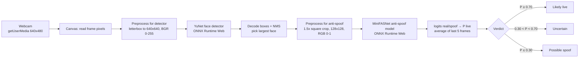
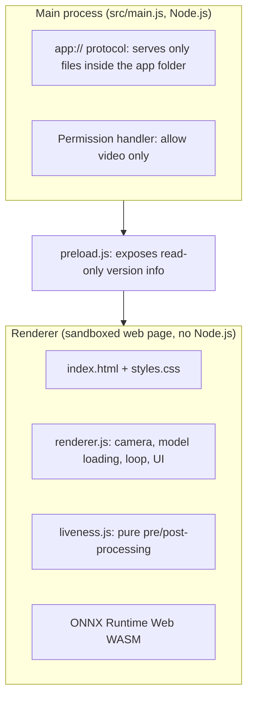

# Browser-Based Face Liveness Detection (Electron)

A small desktop app that looks at your webcam and uses a **real pretrained AI
anti-spoofing model** to judge whether the face in front of it is a **live
person** or a **spoof** (printed photo, or a face shown on a phone/laptop screen).
Everything runs locally with [ONNX Runtime Web](https://onnxruntime.ai/) (WebAssembly).
No image is uploaded or saved.

> Academic demonstration for a college assignment, **not** a production biometric
> security system.


## What it shows

- Camera preview with the detected face outlined (green = likely live, red = possible spoof, amber = uncertain)
- Verdict: **Likely live**, **Possible spoof** or **Uncertain**, plus the live-probability bar
- Measured latency per frame (face detection, anti-spoof model, total) and the size of each model file
- Clear messages for: camera permission denied, no camera, camera busy, missing/corrupt model files, inference errors, no face, face too small

## The model (and how it was checked)

Candidate evaluated: [facenox/face-antispoof-onnx](https://github.com/facenox/face-antispoof-onnx) (commit `2f8dd93`).

| Check | Result |
|---|---|
| License | **Apache-2.0** – redistribution allowed with the license notice (`models/LICENSE-face-antispoof-onnx.txt`) |
| Model | MiniFASNetV2-SE, INT8 quantized, **626 KB** (`antispoof_minifas_int8.onnx`) |
| Input | `[1, 3, 128, 128]` float32, RGB, values 0–1. Face crop = square of 1.5 × face size, reflection padded |
| Output | `[1, 2]` logits `[real, spoof]` → `P(live) = sigmoid(real − spoof)` |
| Needs a face detector? | Yes. The same repo ships YuNet (`detector.onnx`, **232 KB**), used here |
| Browser compatible? | Yes – both models load and run in ONNX Runtime Web 1.20.1 (WASM). The repo's *quantized* detector does **not** run in ORT 1.20, so the FP32 detector is used |
| Size budget (≤ 5 MB) | **858,786 bytes ≈ 0.82 MiB** combined |
| Upstream accuracy | 98.20 % on CelebA-Spoof (reported by upstream, **not** re-measured here) |

Details: [`models/README.md`](models/README.md).

## Architecture



**In plain English:** the webcam frame is drawn onto an invisible canvas so we can
read its pixels. A first, tiny model (YuNet) finds where the face is. We cut out a
square around the face that is 1.5 × the face size (the model was trained to see a
bit of background, which helps it spot photo edges and screen bezels), shrink it to
128 × 128 and feed it to the second model (MiniFASNet). That model outputs two
scores, "real" and "spoof"; the difference passed through a sigmoid is the
probability that the face is live. Because single frames are noisy, the app
averages the last 5 frames before deciding.

### Electron process model



## Important files

| File | What it does |
|---|---|
| `src/main.js` | Creates the window with `contextIsolation: true`, `nodeIntegration: false`, `sandbox: true`. Serves the app over a private `app://` scheme (so `fetch`, WebAssembly and the camera work like on a secure website), refuses paths outside the app folder, grants only video permission, blocks navigation/pop-ups, and asks macOS for camera access. |
| `src/preload.js` | The minimal bridge: exposes `window.appInfo` (Electron/Chrome version, platform, arch). No file system, no IPC. |
| `src/renderer/index.html` | Page layout and a strict Content-Security-Policy (local files only). |
| `src/renderer/renderer.js` | Starts/stops the webcam, loads both ONNX models, runs the per-frame pipeline (`analyzeSource`), measures timings, and updates the UI. |
| `src/renderer/liveness.js` | Pure maths, no DOM: RGBA→tensor conversion, YuNet box decoding + NMS, the 1.5× crop with area resampling, logits→probability→verdict. Shared by the app and the tests. |
| `models/` | The two ONNX files, their license and their verified input/output contract. |
| `scripts/copy-ort.js` | Copies just the 3 ONNX Runtime Web files the app needs into `src/vendor/ort`. |
| `test/` | Unit tests, model tests and an end-to-end test inside Electron. |

## Security and privacy

- Context isolation **on**, renderer Node integration **off**, renderer sandbox **on**.
- Preload exposes only static version strings via `contextBridge`.
- CSP: `default-src 'self'`; scripts only from the app (`'wasm-unsafe-eval'` is needed to compile ONNX Runtime's WebAssembly).
- Permission handler grants `media` only when every requested type is `video` (no microphone, no other permissions).
- Frames live only in memory (canvas → typed arrays → model). Nothing is written to disk or sent over the network; the app makes no network requests at all.

## Run from source

Requirements: **Node.js 22 LTS** (20 also fine) and a webcam.

```bash
npm install
```

```bash
npm start
```

> **Node 26 note (verified):** Electron's own installer (`extract-zip`) stops after the
> first file on Node 26, leaving `node_modules/electron/dist` empty, and `npm start`
> fails with *"Electron failed to install correctly"*. Use Node 22, or repair it once with:
> ```bash
> npx -y node@22 node_modules/electron/install.js
> ```
> npm 11 also blocks dependency install scripts unless approved; the approvals for
> `electron` and `onnxruntime-node` are already in `package.json` (`allowScripts`).

Click **Start camera**, allow camera access when macOS asks, and look at the camera.
Then hold up a printed photo or a phone showing a face to see the spoof result.

## Tests

```bash
npm test
```

Runs 12 Node tests: pipeline maths (`test/liveness.test.js`) and the real model
files with onnxruntime-node (`test/models.test.js`: size ≤ 5 MB, input/output shapes,
no face on a blank image).

End-to-end test of the real app pipeline (Electron + ONNX Runtime Web) on images
you supply:

```bash
npx electron test/e2e-image.js path/to/face.png
```

## Build

```bash
npm run build
```

Produces `release/Face Liveness Detector-1.0.0-mac-arm64.zip` (Apple Silicon, ad-hoc signed).

```bash
npm run source-zip
```

Produces `release/browser-face-liveness-electron-source.zip` (git-tracked files only).

Windows x64: the GitHub Actions workflow **Windows build** (`.github/workflows/windows-build.yml`)
runs the tests and uploads a ZIP artifact. Run it from the repository's *Actions* tab.

## Extract and launch the macOS app (Apple Silicon)

1. Double-click `Face Liveness Detector-1.0.0-mac-arm64.zip` (or run
   `ditto -x -k "Face Liveness Detector-1.0.0-mac-arm64.zip" .`).
   You get **Face Liveness Detector.app**. Optionally drag it into *Applications*.
2. The app is not notarised by Apple, so the first launch is blocked when the ZIP
   was downloaded from the internet. Either:
   - right-click the app → **Open** → **Open**, or, on newer macOS, try to open it once and then go to
     *System Settings › Privacy & Security* and click **Open Anyway**; or
   - in Terminal (adjust the path):
     ```bash
     xattr -dr com.apple.quarantine "/Applications/Face Liveness Detector.app"
     ```
3. Click **Start camera** and choose **Allow** in the macOS camera prompt.
   If you clicked *Don't Allow*, enable it in *System Settings › Privacy & Security › Camera* and restart the app.

## Test results (what actually ran)

Measured on an Apple M3 Mac, macOS 27.0.1, Electron 38.8.6, ONNX Runtime Web 1.20.1 (WASM, 1 thread).

| Test | Result |
|---|---|
| `npm test` (12 unit + model tests) | **Pass** |
| End-to-end in the dev app on a real-face frame (320×240 frame from the upstream demo GIF) | Face found (score 0.93), **P(live) = 0.979** → *Likely live* |
| Same frame through the upstream Python/OpenCV reference pipeline | P(live) 0.967–0.977 (small difference = slightly different face box) |
| JS crop vs Python `preprocess.crop` + `INTER_AREA` on 4 fixed boxes | Identical P(live) to 4 decimal places |
| Latency (median of 5) | detection **≈ 23 ms**, anti-spoof **≈ 9 ms**, whole frame **≈ 37 ms** (target < 500 ms) |
| Packaged `.app` extracted from the ZIP | Signature valid, models load from `app.asar`, same P(live) 0.9794; `require`/`process` are `undefined` in the page |
| Missing model file | UI shows "model file missing: antispoof_minifas_int8.onnx (HTTP 404)" |
| Corrupt model file | UI shows the ONNX Runtime "protobuf parsing failed" error |
| Blank image | No face |

**Not tested by me (needs a person in front of the camera):**
- The live webcam stream itself. Automated launches stopped at the macOS camera
  permission prompt, which has to be answered by a human. The code path for video
  frames is the same `analyzeSource()` used in the image tests.
- Real spoof attacks (printed photo, phone screen). There is no spoof image in
  the test set, so spoof accuracy is **unverified** here; upstream reports 98.73 %
  spoof accuracy on CelebA-Spoof.
- The Windows build is configured in GitHub Actions; check the workflow run for its result.

## Limitations

- Passive, single-camera RGB check. It can be fooled by attacks it was not trained on (3-D masks, high-quality replays) and is sensitive to lighting, blur and pose.
- Thresholds (0.70 / 0.30) and the 5-frame average are simple choices for a demo, not calibrated.
- The detector also fires on some face-like drawings; tiny "faces" (< 64 px) are reported as *Uncertain* instead of being classified.
- Only the largest face is checked.
- The macOS app is ad-hoc signed, not notarised.

## Licenses

- App code: MIT.
- Models: Apache-2.0, © facenox (see `models/LICENSE-face-antispoof-onnx.txt`).
- ONNX Runtime Web: MIT.
